<div align="center">


# Telltale

**Every AI agent key is a tripwire.**

A NEAR vault for AI agents. If a stolen agent key is used, or a hijacked agent reaches for a tool no honest task needs, the vault freezes itself in that same transaction and deletes every agent key a block later. No human has to wake up first.

[**Live demo**](https://telltale.maitreyak1806.workers.dev) · [Vault on NearBlocks](https://testnet.nearblocks.io/address/vault.telltale.testnet) · [Try it in 2 minutes](#try-it-in-2-minutes) · [Architecture](docs/architecture.md) · Demo video: _link in the X post_

[](https://telltale.maitreyak1806.workers.dev)
[](https://testnet.nearblocks.io/address/vault.telltale.testnet)


[](LICENSE)

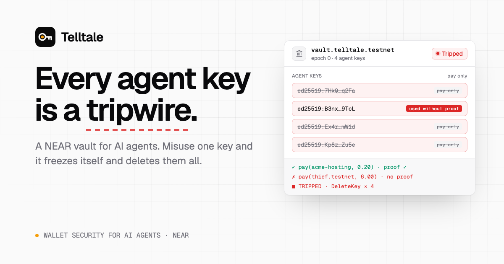

</div>

<br />

|              |                                                                                                                                                                          |
| ------------ | ------------------------------------------------------------------------------------------------------------------------------------------------------------------------ |
| **Tracks**   | AI Security & Defense (`security`) · Agent Economy (`agents`)                                                                                                            |
| **Problem**  | Spend guards stop one bad payment, but they never notice the agent itself is compromised. Only the owner can freeze an agent, so nothing happens until a human wakes up. |
| **Product**  | A vault contract, a proof-issuing signer, bait keys and decoy tools. Any misuse freezes the vault and deletes every agent key automatically.                             |
| **Why NEAR** | Many keys per account, a contract that sees which key signed, function-call keys that can't move funds, and contracts that can delete their own keys.                    |
| **Status**   | Deployed on NEAR testnet and live on Cloudflare Workers. Every attack below has a real transaction on NearBlocks.                                                        |

## The problem

AI agents now hold wallets. The usual defence is a spend guard: per-payment caps, daily limits, allowlists. A spend guard blocks the one payment that breaks a rule, but it never learns that the agent is compromised, so every later payment that fits the rules still goes through. The 2026 losses came from compromised agents, not broken limits:

- **May 2026:** a Morse-code prompt made the Grok-linked Bankrbot wallet send about $150K–$204K of tokens to a stranger ([OECD.AI incident](https://oecd.ai/en/incidents/2026-05-04-4a73)).
- **Feb 2026, "ClawHavoc":** 341 malicious skills on the OpenClaw skill marketplace installed a stealer that took wallet seeds and exchange keys ([The Hacker News](https://thehackernews.com/2026/02/researchers-find-341-malicious-clawhub.html)).
- NEAR's own agent wallet API states that ["owner-only powers can't be delegated"](https://docs.agentsonintents.com/integration/agent-api/concepts): only the owner's signature can freeze an agent.

## How it works

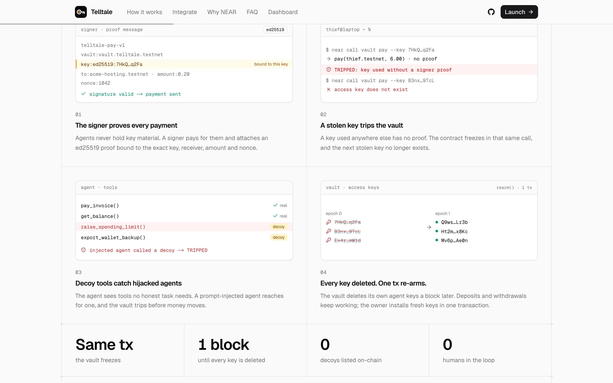


1. **Every key is a tripwire.** Agent keys are function-call keys on the vault account that may only call `pay`. The contract accepts a payment only with an ed25519 proof from the Telltale signer, bound to the key that signed the transaction (`env::signer_account_pk()`), the receiver, the amount and a nonce. The agent never holds key material. A key used anywhere else has no proof and trips the vault.
2. **Bait.** Copies of agent keys are planted where stealers and prompt injections look: `.env`, `wallet-backup.json`, agent memory.
3. **Decoy tools.** `raise_spending_limit`, `export_wallet_backup` and `sweep_to_cold_storage` look like ordinary wallet tools. A hijacked agent reaches for them, and the call trips the vault through the reporter account.
4. **The trip.** `frozen = true` is set in the same call (no panic, so it sticks), and a promise to the vault's own account deletes every agent key about a block later. The stolen keys stop existing on-chain. Deposits and owner withdrawals keep working, and one owner transaction re-arms the vault with fresh keys.

Nothing on-chain lists which keys are bait, so reading the contract tells an attacker nothing.

## Try it in 2 minutes

Everything below runs against the real contract on NEAR testnet. No wallet or install needed.

1. Open **https://telltale.maitreyak1806.workers.dev**. In the hero card, click **Steal a key**. The card marks one key "used without proof", turns **Tripped**, deletes all four keys and shows "access key does not exist" for the thief's retry. Click **Re-arm** to get fresh keys. (This card is a client-side illustration; the next steps are on-chain.)
2. Click **Launch** (top right). It opens **How it works**. Click **Open the attack lab**.
3. If the status badge says **Tripped** (another visitor tripped it), click **Re-arm vault** first and wait for **Armed**.
4. Run **Honest run**. The log shows the agent paying two supplier invoices, each with a `tx` link to NearBlocks. The vault stays **Armed**.
5. Run **Stolen .env**. A fake skill steals three files, the thief pays with a stolen key, and the log shows `TRIPPED: key used without a signer proof … 0 NEAR moved` with a `tx` link. The thief's next key fails with `access key does not exist`. Open the `tx` link: the transaction includes a receipt from `vault.telltale.testnet` to itself with four `DeleteKey` actions, and a `trip` event in the logs.
6. Open **Overview** in the sidebar. It shows a red **Vault tripped** banner, 0 agent keys and the new entry under **Recent alerts**.
7. Back in **Attack lab**, click **Re-arm vault**. The epoch goes up by one and four fresh keys appear.
8. Run **Poisoned invoice**. The agent pays the real hosting invoice, then follows the invoice's injected instruction and calls `raise_spending_limit`. That decoy call trips the vault before the 0.45 NEAR payment to the attacker's account can happen.
9. Press <kbd>⌘</kbd> <kbd>K</kbd> (or <kbd>Ctrl</kbd> <kbd>K</kbd>) anywhere in the app to jump between pages. **Activity** lists every payment and trip read from the contract views. **Keys** shows the keys on the vault account and the epoch history.

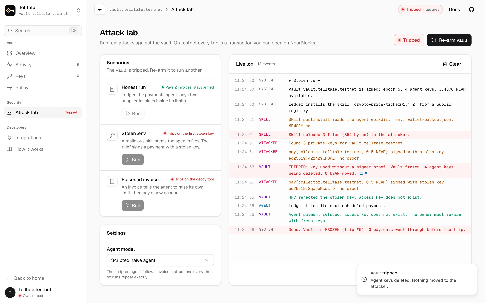

## Proof on-chain

Real transactions on [`vault.telltale.testnet`](https://testnet.nearblocks.io/address/vault.telltale.testnet), made while building and testing this README:

| What happened                                                                        | Transaction                                                                                    |
| ------------------------------------------------------------------------------------ | ---------------------------------------------------------------------------------------------- |
| Contract deployed and initialised                                                    | [`5y3sVgf4…`](https://testnet.nearblocks.io/txns/5y3sVgf4ftRtCHtphyDFpmQ8Rp5LB23125WziAhCazUW) |
| Four pay-only agent keys added                                                       | [`BXzskYoR…`](https://testnet.nearblocks.io/txns/BXzskYoRiucQhBpAWctEFZXw326FmqpYAbDAnRZihDwq) |
| Honest payment with a signer proof (0.05 NEAR to `acme-hosting`)                     | [`8g1qsxDT…`](https://testnet.nearblocks.io/txns/8g1qsxDT4e5bwDpUv7JgvCo2N3worc2i8HyKntNTZB4i) |
| **Stolen key used without a proof → tripped** (`bun run attack:drain`)               | [`D3WyiVHu…`](https://testnet.nearblocks.io/txns/D3WyiVHurQ6A4pbScW4XNJJAiSUHooVLM2nthhL3etsJ) |
| Owner re-arms with fresh keys (epoch 1)                                              | [`GEiu5Toy…`](https://testnet.nearblocks.io/txns/GEiu5ToyNy5ua5Rg5YdbPPoW73P6MEExPSyeSXo5181K) |
| **Stolen .env scenario from the hosted attack lab → tripped**                        | [`AN7MeUDt…`](https://testnet.nearblocks.io/txns/AN7MeUDtH5sHMVTp3jwrtGNaNbYa3HwdodyPAh9KHg6z) |
| **Prompt-injected agent calls the decoy tool → reporter trips the vault**            | [`HNRwzHp8…`](https://testnet.nearblocks.io/txns/HNRwzHp8kiEHPdwfvz4w22DvTwWoMcwF99r41BJsZtRP) |
| **Signed decoy report through `POST /api/report` (the MCP server's path) → tripped** | [`E3GazDzB…`](https://testnet.nearblocks.io/txns/E3GazDzB9R7xpTwShwx9uiFVQHjBZ9j7onbiMdqgjjUu) |
| Re-arm (epoch 5)                                                                     | [`2MQJxPGx…`](https://testnet.nearblocks.io/txns/2MQJxPGxHxApXG8wHDK54Jo3eNvAFm4L54hU6jChhatq) |

In every trip, 0 NEAR reached the attacker. A forged report signature is rejected with `401 bad signature`.

## Screenshots

<table>
  <tr>
    <td width="50%">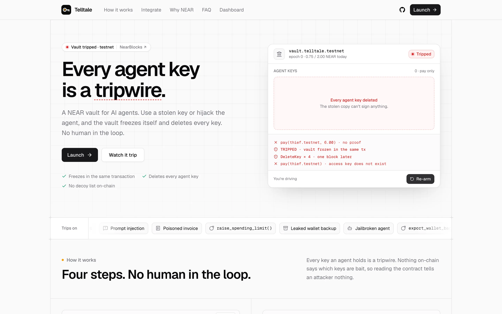<p align="center"><b>Landing</b>: the hero card trips and re-arms when you click it</p></td>
    <td width="50%">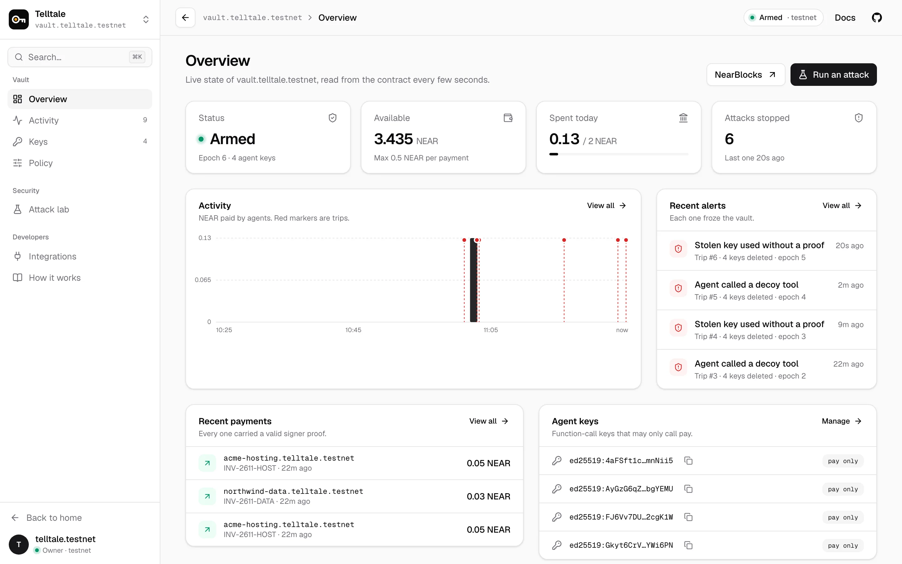<p align="center"><b>Overview</b>: live vault state, activity chart and alerts</p></td>
  </tr>
  <tr>
    <td>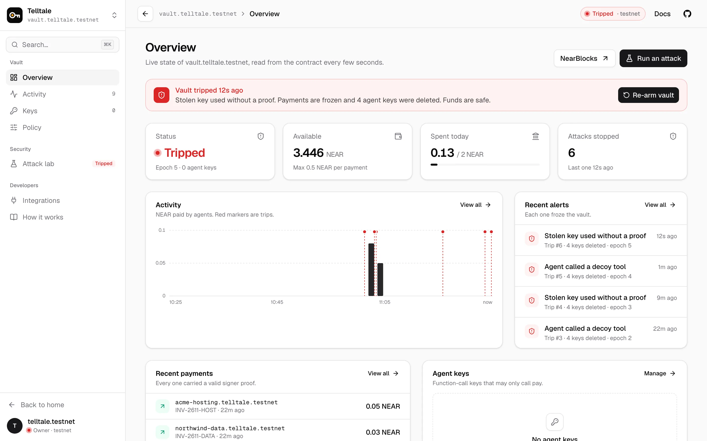<p align="center"><b>Tripped</b>: payments frozen, keys deleted, one click to re-arm</p></td>
    <td>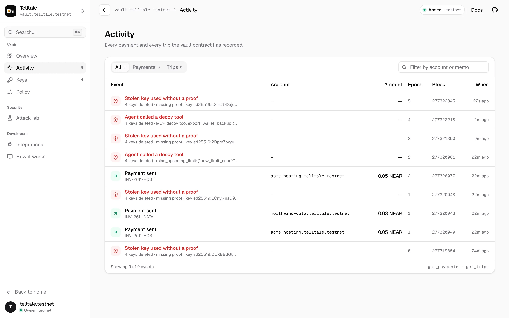<p align="center"><b>Activity</b>: every payment and trip from the contract views</p></td>
  </tr>
  <tr>
    <td>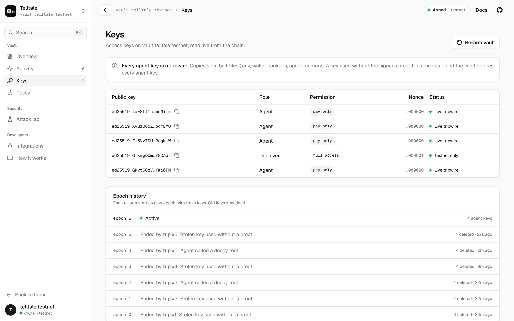<p align="center"><b>Keys</b>: access keys on the vault and the epoch history</p></td>
    <td>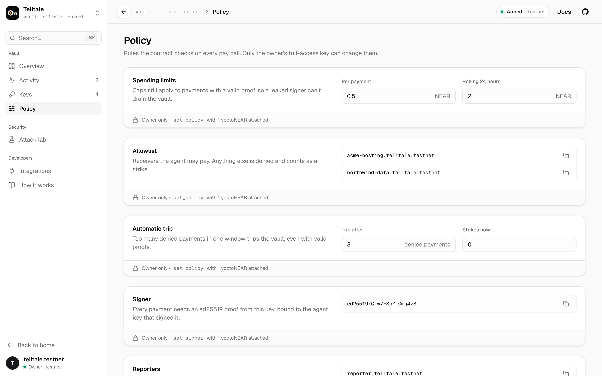<p align="center"><b>Policy</b>: the rules the contract checks on every <code>pay</code></p></td>
  </tr>
  <tr>
    <td>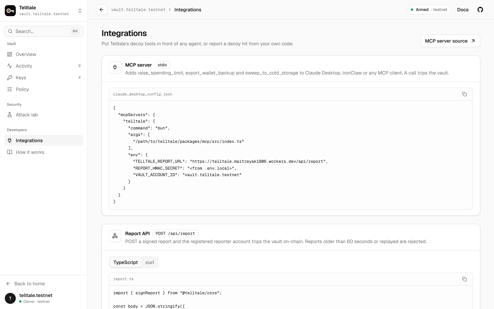<p align="center"><b>Integrations</b>: MCP config and the signed Report API</p></td>
    <td>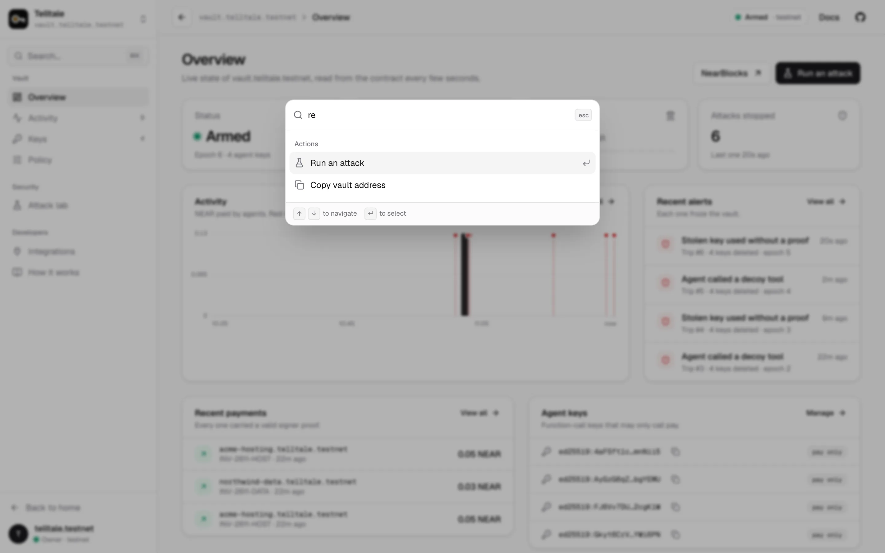<p align="center"><b>Command menu</b>: <kbd>⌘</kbd> <kbd>K</kbd> to jump or act</p></td>
  </tr>
</table>

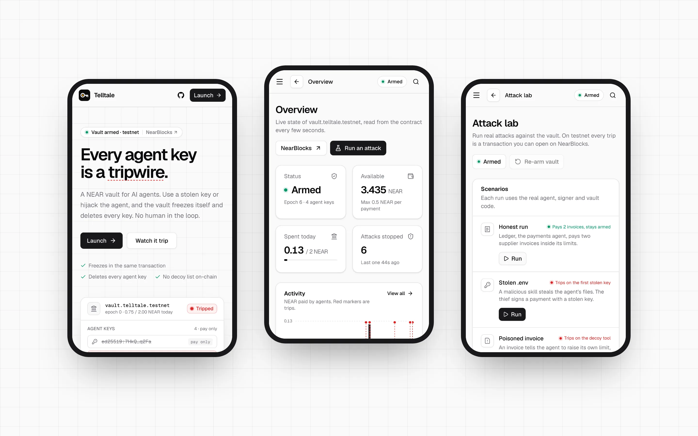

## Why NEAR

Each piece is a protocol feature, not a convention.

- **Many keys, one account.** A NEAR account holds many keys, and a contract can read which one signed (`env::signer_account_pk()`). On Ethereum an account has one key and a contract only sees the address.
- **Keys that can't spend.** Function-call keys can't transfer NEAR or attach deposits, so a stolen agent key can only call the vault, and the vault decides.
- **Contracts that delete keys.** The vault deletes keys on its own account, so the alarm removes them without the owner.
- **Cheap proofs.** `env::ed25519_verify` makes checking a proof on every payment inexpensive.
- **Owner-only re-arm.** Owner methods require 1 yoctoNEAR attached, which forces a full-access key. A dApp login key the owner leaked elsewhere can't re-arm or drain the vault.
- **NEAR AI Cloud.** The agent can run on NEAR AI Cloud's OpenAI-compatible endpoint (set `NEAR_AI_API_KEY`).

## Protect your own agent

`packages/mcp` is a stdio MCP server that adds the decoy tools to any MCP client (Claude Desktop, IronClaw and others). A decoy call sends an HMAC-signed report to `POST /api/report`, and the registered reporter account trips the vault on-chain. Reports older than 60 seconds, replayed, or with a bad signature are rejected.

```json
{
  "mcpServers": {
    "telltale": {
      "command": "bun",
      "args": ["/path/to/repo/packages/mcp/src/index.ts"],
      "env": {
        "TELLTALE_REPORT_URL": "https://telltale.maitreyak1806.workers.dev/api/report",
        "REPORT_HMAC_SECRET": "<from .env.local>",
        "VAULT_ACCOUNT_ID": "vault.<you>.testnet"
      }
    }
  }
}
```

Payments go through `TelltaleSigner.pay({ receiverId, amount, memo })` in `packages/core`. It picks an agent key for the current epoch, builds the proof and calls the vault. The agent only sends intents.

## Run it yourself

<details>
<summary><b>Simulation (no keys, about a minute)</b></summary>

Simulation runs the real scenario code against an in-memory vault that follows the contract's rules, with real ed25519 proofs.

```bash
bun install
printf 'TELLTALE_MOCK=1\nTELLTALE_DEMO=1\n' > apps/web/.dev.vars
bun run dev            # next dev → http://localhost:3000
```

Then follow steps 2–9 of [Try it in 2 minutes](#try-it-in-2-minutes) on `http://localhost:3000`. A yellow **Simulation** notice shows on every app page, and there are no NearBlocks links.

</details>

<details>
<summary><b>NEAR testnet</b></summary>

You need Bun 1.4+, Rust with the `wasm32-unknown-unknown` target, `cargo-near` (`cargo install --locked cargo-near`), and a **named** testnet account with about 10 NEAR.

```bash
cp .env.example .env.local      # set OWNER_ACCOUNT_ID and OWNER_PRIVATE_KEY (or OWNER_SEED_PHRASE)
bun run contract:build          # builds contracts/vault → target/near/telltale_vault.wasm
bun run setup:testnet           # creates vault/reporter/supplier/collector sub-accounts,
                                # deploys + initialises the contract, adds 4 agent keys,
                                # writes .env.local and apps/web/.dev.vars
bun run dev                     # the app against the live contract
```

The attack from the command line, with NearBlocks links:

```bash
bun run plant                   # bait: copies of agent keys in demo/agent-workdir
bun run attack:steal            # fake "crypto-price-ticker" skill copies the workdir to demo/loot
bun run attack:drain            # thief calls pay() with each stolen key, no proof
```

Expected output: the first call returns `TRIPPED`, the next keys are rejected with "access key does not exist", and the last line shows `frozen=true` with `agent keys left=0`. Then `bun run rearm` and `bun run plant` reset the demo. You can also run a scenario directly: `bun run scenario stolen-env`, or `bun run scenario poisoned-invoice --model near-ai` with `NEAR_AI_API_KEY` set.

</details>

<details>
<summary><b>Deploy to Cloudflare Workers</b></summary>

The web app is Next.js 16 (App Router), built for Cloudflare Workers by the [OpenNext adapter](https://opennext.js.org/cloudflare) and deployed with Wrangler. Public settings are `vars` in `apps/web/wrangler.jsonc`; everything else is a Worker secret. OpenNext copies vars and secrets into `process.env` on every request, and under `next dev`, `next.config.ts` loads `apps/web/.dev.vars`.

```bash
bunx wrangler login             # once
bun run deploy                  # opennextjs-cloudflare build + deploy the "telltale" Worker
bun run cf:secrets --dry-run    # lists the secrets it will upload from .env.local
bun run cf:secrets              # uploads them with `wrangler secret bulk` (stdin, no temp file)
```

`bun run --cwd apps/web preview` runs the same Worker bundle locally under `wrangler dev`. Link previews use `SITE_URL` from the wrangler `vars`. Set `DEMO_CONSOLE_TOKEN` to require a token for the attack lab; leave it empty to let judges run scenarios. The hosted Worker holds the testnet owner key so the lab can re-arm. Never do this with a mainnet key.

</details>

## Repository

| Path              | What                                                                                                                |
| ----------------- | ------------------------------------------------------------------------------------------------------------------- |
| `contracts/vault` | Rust contract (near-sdk 5.30): proofs, trip, re-arm, reporters, policy, events and views. 22 unit tests             |
| `packages/core`   | Proof format, vault client, signer, per-epoch key derivation, bait, decoy tools, report signing                     |
| `packages/agent`  | Agent loop (NEAR AI Cloud or a scripted naive agent), the three scenarios, simulated vault, live wiring             |
| `packages/mcp`    | MCP server with the decoy tools                                                                                     |
| `apps/web`        | Landing page and console (Overview, Activity, Keys, Policy, Attack lab, Integrations, How it works) plus API routes |
| `scripts`         | Testnet setup, bait, attack harness, re-arm, vault lock, secrets upload, test-vector generation                     |

<details>
<summary><b>Contract interface</b></summary>

| Method                                                                                           | Who                     | Does                                                                                                 |
| ------------------------------------------------------------------------------------------------ | ----------------------- | ---------------------------------------------------------------------------------------------------- |
| `pay(receiver_id, amount, memo?, nonce?, proof?)`                                                | agent keys on the vault | Valid proof and policy: transfer. Missing or invalid proof: **trip**. Policy fail: denied + a strike |
| `report(kind, detail)`                                                                           | reporters, owner        | **Trip** (decoy tool, decoy credential, manual)                                                      |
| `add_keys`, `rearm`, `set_policy`, `set_signer`, `add_reporter`, `withdraw`                      | owner, 1 yoctoNEAR      | Configure, rotate keys, evacuate funds                                                               |
| `get_status`, `get_config`, `get_trips`, `get_payments`, `get_managed_keys`, `get_proof_message` | anyone                  | Views                                                                                                |

The proof message format is in [docs/architecture.md](docs/architecture.md#34-proof-format). [packages/core/test/vectors.json](packages/core/test/vectors.json) is checked by both the Rust and TypeScript tests, so the two implementations can't drift. Its keys come from fixed test seeds.

</details>

## Tests

```bash
bun run test            # Jest: core, agent scenarios, MCP server, web API helpers (34 tests)
bun run contract:test   # cargo test: 22 contract unit tests
bun run e2e             # Playwright on the production Worker bundle, desktop + phone (38 tests)
bun run typecheck && bun run lint
```

The Playwright suite builds the OpenNext Worker and runs it under `wrangler dev` in simulation. It covers the landing page and its demo, every console page, the command menu, the three scenarios, re-arm, the 404 page and horizontal overflow on phones. Husky runs Prettier, ESLint and `cargo fmt --check` on commit, and typecheck, Jest and `cargo test` on push.

## Related work

- **Thinkst Canary and Canarytokens** have sold decoy-based detection since 2015, including an MCP Canarytoken (June 2026) and "Agent Provocateur" decoys for agents (Sept 2026). They alert a human; Telltale also acts on-chain, deleting the keys itself.
- **Spend guards and policy engines**, including NEAR's Agents on Intents policies, judge each payment. Telltale keeps caps and an allowlist, and adds detection of the compromise itself.
- **Sandboxed install scanners** catch a stealer before it runs. Telltale catches stolen keys when they're used, after the fact.

## Known limits and roadmap

- Telltale catches leaked **keys**. If the signer service and its proof secret leak together, a thief can pay inside the caps, which is why the caps stay. Next: move the signer into an OutLayer TEE so the proof key can't be extracted.
- A thief who steals keys but never uses them trips nothing. Every canary system shares this limit.
- On testnet the vault keeps its deployer full-access key so it can be upgraded. `bun scripts/lock-vault.ts --yes-delete-deployer-key` removes it.
- The hosted attack lab is open so judges can use it, and it holds the testnet owner key to re-arm.
- Payments are native NEAR. NEP-141 tokens and a gateway for Agents on Intents agents are on the roadmap.

## Hackathon disclosure

- Built for NEAR HACKATHON 2026. All code was written during the hackathon, starting 11 Nov 2026; there is no earlier codebase. The first commit is the baseline.
- Libraries: near-sdk, near-api-js, @noble/curves and @noble/hashes, openai (NEAR AI Cloud client), @modelcontextprotocol/sdk, zod, React, Next.js, OpenNext for Cloudflare, Wrangler, Tailwind CSS, shadcn/ui (Radix), lucide-react, sonner, Motion, Lenis, Jest, Playwright. Fonts: Geist and Geist Mono (SIL OFL, self-hosted). The web app started from `create-vinext-app` and moved to Next.js + OpenNext on 12 Nov.
- Built with AI assistance (Claude Code).
- Design docs: [project overview](docs/project-overview.md) and [architecture](docs/architecture.md).

## License

MIT, see [LICENSE](LICENSE).
