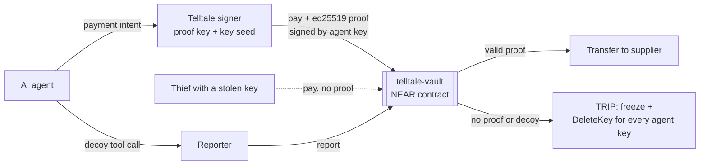

# Telltale

**Every AI agent key is a tripwire.** Telltale is a vault contract on NEAR plus a signer, decoy tools and bait. If an attacker uses a stolen agent key, or a hijacked agent reaches for a tool no honest task needs, the vault freezes itself and deletes every key the agent holds in the same transaction. No human has to wake up first.

Built at NEAR HACKATHON 2026 for **AI Security & Defense** (`security`) and **Agent Economy** (`agents`).

- Live demo: _added after deploy_ · Demo video: _added after recording_
- Web app: landing page at `/`, then **Overview** (`/dashboard`), **Attack lab** (`/lab`) and **How it works** (`/how-it-works`). Next.js 16 on Cloudflare Workers.
- Design docs: [docs/project-overview.md](docs/project-overview.md), [docs/architecture.md](docs/architecture.md)

## The problem

Agents now hold wallets, and the usual defence is a spend guard: caps, allowlists, daily limits. A spend guard blocks one bad payment, but it never learns that the agent itself is compromised, so every later payment that fits the rules still goes through. The 2026 losses came from compromised agents:

- **May 2026:** a Morse-code prompt made the Grok-linked Bankrbot wallet send about $150K–$204K in tokens.
- **Feb 2026, "ClawHavoc":** 341 malicious skills on the OpenClaw marketplace installed a stealer that took wallet seeds and exchange keys.

NEAR's own agent wallet API also says "owner-only powers can't be delegated": only the owner's signature can freeze an agent.

## How it works



1. **Every key is a tripwire.** Agent keys are function-call keys on the vault account that may only call `pay`. The contract accepts a payment only with an ed25519 proof from the Telltale signer, bound to the key that signed the transaction (`env::signer_account_pk()`), the receiver, the amount and a nonce. A key used anywhere else trips the vault.
2. **Bait.** Copies of agent keys are planted where stealers and prompt injections look: `.env`, a wallet backup file, agent memory.
3. **Decoy tools.** `raise_spending_limit`, `export_wallet_backup` and `sweep_to_cold_storage` look like ordinary wallet tools. A hijacked agent reaches for them, and the call trips the vault.
4. **The trip.** `frozen = true` in the same call, then a promise to the vault's own account deletes every agent key about a block later. Stolen keys stop existing on-chain. The owner can still withdraw, and re-arms with one transaction.

There is no list of decoys on-chain, so reading contract state tells an attacker nothing.

## Why NEAR

- One account holds many keys, and a contract can see which key signed. On Ethereum an account has one key and a contract only sees the address.
- Function-call keys can't transfer NEAR or attach deposits, so a stolen key can only call the vault, and the vault decides.
- A contract can delete keys on its own account, so the alarm removes the keys without the owner.
- `env::ed25519_verify` makes checking a proof on every payment cheap.
- Owner methods require 1 yoctoNEAR attached, which forces a full-access key. A dApp login key the owner leaked elsewhere can't re-arm or drain the vault.
- The agent's model runs on NEAR AI Cloud (OpenAI-compatible, TEE-hosted models).

## Try it in two minutes (simulation, no keys needed)

Simulation mode runs the real scenario code against an in-memory vault that follows the contract's rules, with real ed25519 proofs.

```bash
bun install
printf 'TELLTALE_MOCK=1\nTELLTALE_DEMO=1\n' > apps/web/.dev.vars
bun run dev            # next dev → http://localhost:3000
```

`/` is the landing page; **Launch** opens the app. The app has three pages: **Overview** (vault state, keys, trips, payments), **Attack lab** (run scenarios with a live log) and **How it works**.

1. Open http://localhost:3000/dashboard. The Overview shows **ARMED** with four `pay only` agent keys.
2. Go to **Attack lab** and run **Stolen .env**. The log shows the skill stealing three files, the thief's first key returning **TRIPPED**, the second key rejected with "access key does not exist", and the agent locked out. The status turns red. Back on Overview, the key list is empty and the trip log has a new entry.
3. Click **Re-arm vault (owner)**. Four fresh keys appear and the epoch goes up by one.
4. Run **Poisoned invoice**. The agent pays the real hosting invoice, then follows the invoice's instruction to call `raise_spending_limit`. That decoy call trips the vault before the 0.45 NEAR payment to the attacker's account can happen.
5. Re-arm, then run **Honest run**. Two supplier invoices are paid and the vault stays armed.

## Run it on NEAR testnet

You need Bun 1.4+, Rust with the `wasm32-unknown-unknown` target, `cargo-near` (`cargo install --locked cargo-near`), and a **named** testnet account with about 10 NEAR.

```bash
cp .env.example .env.local      # set OWNER_ACCOUNT_ID and OWNER_PRIVATE_KEY
bun run contract:build          # builds contracts/vault → target/near/telltale_vault.wasm
bun run setup:testnet           # creates vault/reporter/supplier/collector sub-accounts,
                                # deploys + initialises the contract, adds 4 agent keys,
                                # writes .env.local and apps/web/.dev.vars
bun run dev                     # dashboard against the live contract
```

The attack from the command line, with NearBlocks links:

```bash
bun run plant                   # bait: copies of agent keys in demo/agent-workdir
bun run attack:steal            # fake "crypto-price-ticker" skill copies the workdir to demo/loot
bun run attack:drain            # thief calls pay() with each stolen key, no proof
```

Expected output: the first call returns `TRIPPED`, the next key is rejected with "access key does not exist", and the final line shows `frozen=true` with `agent keys left=0`. Then `bun run rearm` and `bun run plant` reset the demo.

You can also run a scenario directly: `bun run scenario stolen-env`, `bun run scenario poisoned-invoice --model near-ai` (needs `NEAR_AI_API_KEY`).

## Deploy to Cloudflare Workers

The web app is Next.js 16 (App Router), deployed to Cloudflare Workers with the official [OpenNext adapter](https://opennext.js.org/cloudflare) (`@opennextjs/cloudflare`) and Wrangler. Public settings are in `apps/web/wrangler.jsonc`, and everything else is a Worker secret. On every request OpenNext copies the Worker's vars and secrets into `process.env`; under `next dev`, `next.config.ts` loads `apps/web/.dev.vars` instead.

```bash
bunx wrangler login             # once
bun run deploy                  # opennextjs-cloudflare build + deploy the "telltale" Worker
bun run cf:secrets --dry-run    # lists the secrets it will upload from .env.local
bun run cf:secrets              # uploads them with `wrangler secret bulk` (stdin, no temp file)
```

`bun run --cwd apps/web preview` runs the same Worker bundle locally under `wrangler dev`. To give link previews absolute image URLs, build with `SITE_URL=https://telltale.<your-subdomain>.workers.dev bun run deploy` once you know the Worker URL.

Set `DEMO_CONSOLE_TOKEN` to require a token for the red-team console. Leave it empty to let judges run scenarios. The hosted Worker holds the testnet owner key so the console can re-arm. Never do this with a mainnet key.

## Protect your own agent (MCP)

`packages/mcp` is a stdio MCP server that adds the decoy tools to any MCP client (Claude Desktop, IronClaw and others):

```json
{
  "mcpServers": {
    "telltale": {
      "command": "bun",
      "args": ["/path/to/repo/packages/mcp/src/index.ts"],
      "env": {
        "TELLTALE_REPORT_URL": "https://<your-worker>/api/report",
        "REPORT_HMAC_SECRET": "<from .env.local>",
        "VAULT_ACCOUNT_ID": "vault.<you>.testnet"
      }
    }
  }
}
```

A decoy call sends an HMAC-signed report to `/api/report`, which trips the vault through the registered reporter account.

## Repository

| Path              | What                                                                                                                                                     |
| ----------------- | -------------------------------------------------------------------------------------------------------------------------------------------------------- |
| `contracts/vault` | Rust contract (near-sdk 5.30): proofs, trip, re-arm, reporters, events, 22 unit tests                                                                    |
| `packages/core`   | Proof format, vault client, signer, key derivation, bait, decoy tools, reporter HMAC                                                                     |
| `packages/agent`  | Agent loop (NEAR AI Cloud or a scripted naive agent), scenarios, simulated vault, live wiring                                                            |
| `packages/mcp`    | MCP server with decoy tools                                                                                                                              |
| `apps/web`        | Landing page (Motion + Lenis), Overview, Attack lab and How it works (shadcn/ui, light theme), API routes; Next.js 16 on Cloudflare Workers via OpenNext |
| `scripts`         | Testnet setup, bait, attack harness, re-arm, vault lock, secrets upload, test-vector generation                                                          |

### Contract interface

| Method                                                                                           | Who                     | Does                                                                                            |
| ------------------------------------------------------------------------------------------------ | ----------------------- | ----------------------------------------------------------------------------------------------- |
| `pay(receiver_id, amount, memo?, nonce?, proof?)`                                                | agent keys on the vault | Valid proof and policy: transfer. Missing/invalid proof: **trip**. Policy fail: denied + strike |
| `report(kind, detail)`                                                                           | reporters, owner        | **Trip** (decoy tool, decoy credential, manual)                                                 |
| `add_keys`, `rearm`, `set_policy`, `set_signer`, `add_reporter`, `withdraw`                      | owner, 1 yocto          | Configure, rotate, evacuate                                                                     |
| `get_status`, `get_config`, `get_trips`, `get_payments`, `get_managed_keys`, `get_proof_message` | anyone                  | Views                                                                                           |

The proof message format is in [docs/architecture.md](docs/architecture.md#34-proof-format). [packages/core/test/vectors.json](packages/core/test/vectors.json) is checked by both the Rust and TypeScript tests, so the two implementations can't drift.

## Tests

```bash
bun run test            # Jest: core, agent scenarios, MCP server, web API helpers (34 tests)
bun run contract:test   # cargo test: 22 contract unit tests
bun run e2e             # Playwright on the production Worker bundle: landing, 3 app pages, 3 scenarios, 404, desktop + phone (24 tests)
bun run typecheck && bun run lint
```

Husky runs lint-staged on commit (Prettier, ESLint, `cargo fmt --check`). On push it runs typecheck, Jest and `cargo test`.

## Known limits

- Telltale catches leaked **keys**. If the signer service and its proof secret leak together, a thief can pay inside the caps, which is why the caps stay. Roadmap: move the signer into an OutLayer TEE so the proof key can't be extracted.
- A thief who steals keys but never uses them trips nothing. Every canary system shares this limit.
- On testnet the vault keeps its deployer full-access key so it can be upgraded. `bun scripts/lock-vault.ts --yes-delete-deployer-key` removes it.
- Payments are native NEAR. NEP-141 tokens and a gateway for NEAR Intents agents are on the roadmap.

## Hackathon disclosure

- All code was written during NEAR HACKATHON 2026 (from 11 Nov 2026). No earlier codebase.
- Libraries: near-sdk, near-api-js, @noble/curves and @noble/hashes, openai (NEAR AI Cloud client), @modelcontextprotocol/sdk, React, Next.js, OpenNext for Cloudflare, Wrangler, Tailwind CSS, shadcn/ui, Motion, Lenis, Jest, Playwright. Fonts: Geist and Instrument Serif (SIL OFL, self-hosted). The web app started from `create-vinext-app` and moved to Next.js + OpenNext on 12 Nov.
- Built with AI assistance (Claude Code).

## License

MIT, see [LICENSE](LICENSE).
